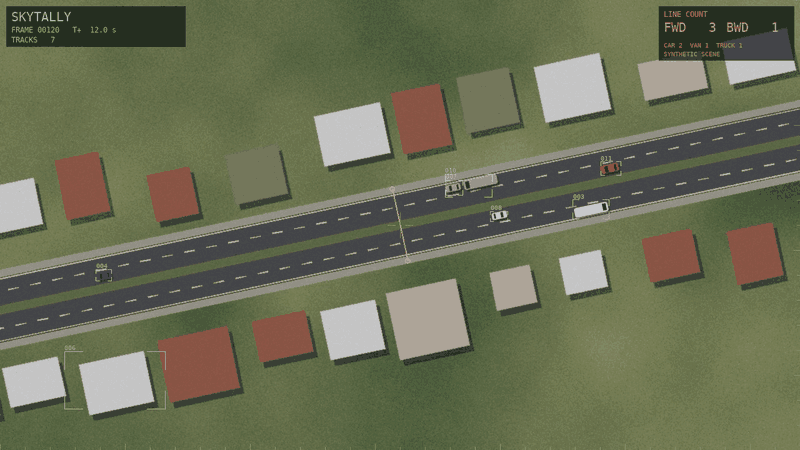
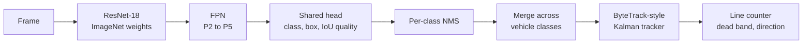
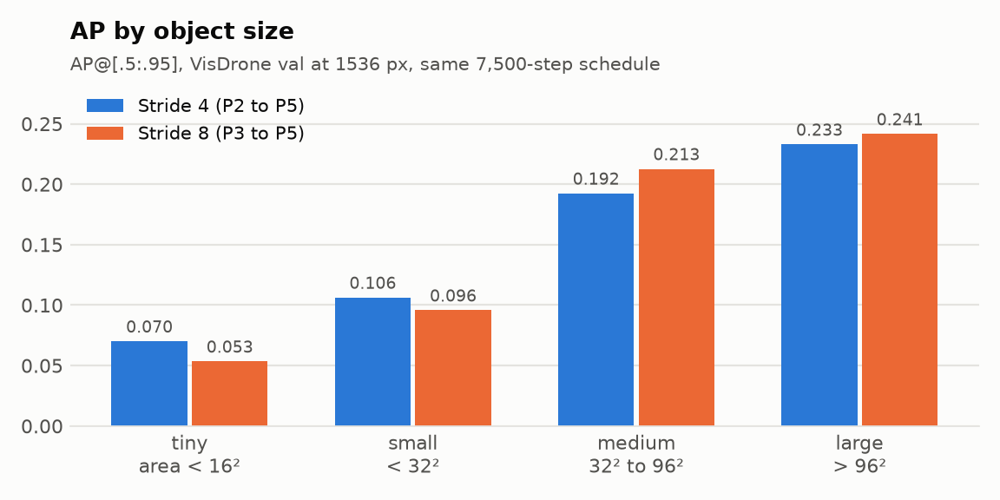
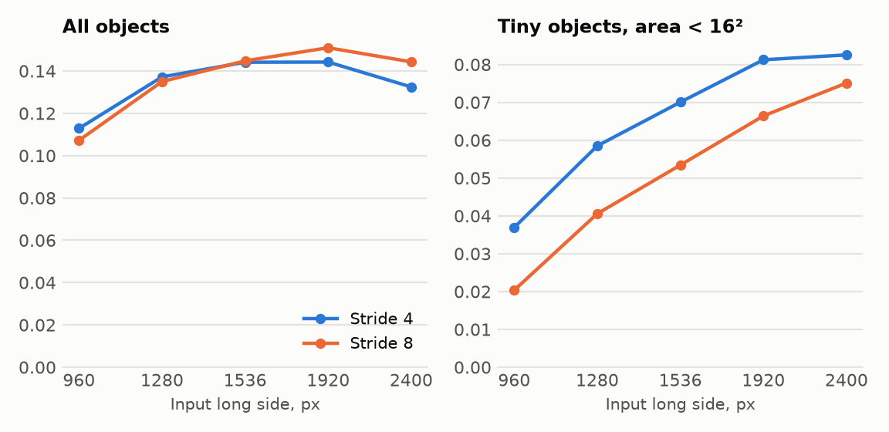
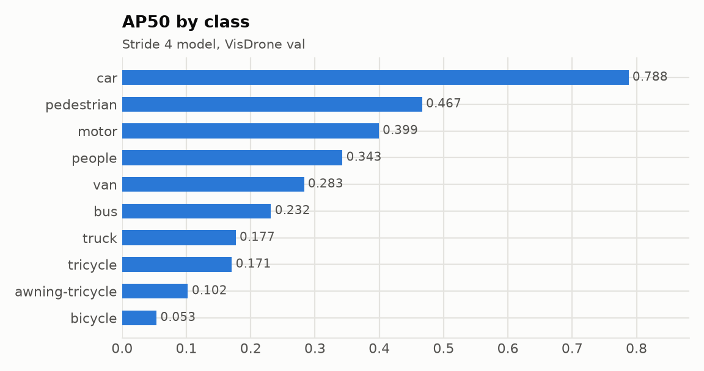
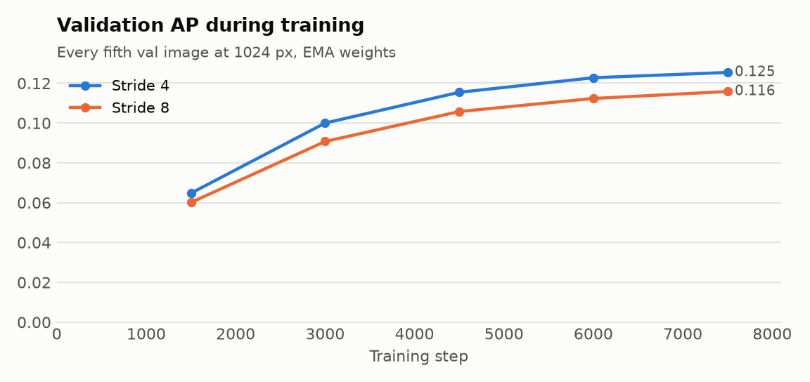

# skytally

[](https://github.com/matejpopovski/skytally/actions/workflows/ci.yml)

Counts vehicles crossing a line in drone footage, where a car can be 15 pixels long. It has
an anchor-free detector written by hand, a ByteTrack-style tracker and a virtual counting
line, and it was trained and run on an Apple M3 Max with PyTorch MPS.



*Real pipeline output on a rendered scene, not on footage: the trained detector, tracker and
counter drawing their own overlay. Track 006 is a genuine false positive on a rooftop.
Scenes are rendered because VisDrone's terms do not clearly allow publishing its images
(see [Data and licences](#data-and-licences)).*

## Readout

| Measurement | Result | Source |
|---|---|---|
| Best AP / AP50 on VisDrone val | **0.151 / 0.308**, stride 8 at 1920 px | `results/resolution_p3_1920.json` |
| AP / AP50, stride 4 at 1536 px | 0.144 / 0.301 | `results/eval_p2.json` |
| Tiny-object AP (area below 16²) | 0.070 at stride 4, 0.053 at stride 8, both at 1536 px | `results/eval_p{2,3}.json` |
| Car AP50, stride 4 at 1536 px | 0.788 | `results/eval_p2.json` |
| mAP code against pycocotools | maximum difference 0.0 over 204,000 tensor entries | `results/map_crosscheck.json` |
| Count error, whole pipeline on rendered scenes | **10.2%** (132 of 147 crossings), simulator | `results/e2e_sim.json` |
| Network latency at 1536 px | 33 ms stride 4, 23 ms stride 8 (M3 Max, 36 GB, MPS) | `results/latency_p{2,3}.json` |
| Training | 74.5 min for both models, peak 7.1 GB | `results/train_p{2,3}.jsonl` |

These AP figures are modest. They come from a ResNet-18 trained for under an hour, and
[the comparison below](#detector-results) shows how far they sit from published work.

## Why this is hard

Measured on the 343,204 training objects (`results/dataset_stats.json`):

- The median object is 26 px across. 26% have an area under 16², and 60% are under 32².
- Images hold 53 objects on average and up to 902.
- 10,343 ignored regions mark areas with unlabelled objects. Treating them as background
  would teach the model that real vehicles are background.
- A detector looks at a grid of points, and small objects can fall between them. At stride 8,
  5.2% of objects, and 20.1% of the tiny ones, contain no grid point at all. At stride 4 that
  falls to 0.8% and 3.1%.

Tracking adds a second problem. A 12-pixel car moving 12 pixels per frame has no overlap with
its own previous box, so the overlap test most trackers rely on has nothing to work with.

## How it works



The target assignment, focal loss, NMS, mAP, Kalman filter, association, MOT metrics and
counter are written by hand. Only the ResNet layers come from torchvision, and the Hungarian
solver comes from SciPy.

**Every object gets at least one training point.** Each object goes to one pyramid level by
size, and its positives are the grid points inside it near its centre. Plain FCOS silently
drops an object with no such point, which from the numbers above would mean one tiny object in
five at stride 8. Here it is matched to its nearest point instead. That point may lie outside
the object, where FCOS's distances to the four edges would be negative, so the head predicts a
centre offset and a log size. An exponential size also means a box can never invert.

**Quality replaces centerness.** Centerness depends on a point's distance to the box edges,
which is noise on an object two cells wide and undefined outside it. A small branch predicts the
IoU of the box it is about to output. This was a design call and was not measured separately.

**Ignored regions produce no loss.** The same goes for objects a crop cuts down to a sliver,
which move to the ignore list instead of becoming background.

**The evaluator is held to pycocotools.** On real predictions the two agree exactly, and tests
compare the full precision and recall tensors on random scenes with ties, crowds and a custom
tiny bucket. Ours took 10.7 s where pycocotools took 36.1 s, because greedy matching is
prefix-stable and only has to run once per area range.

Rejected along the way:

- **GroupNorm in the head.** On MPS it runs through a Python fallback in `torch/_refs` instead
  of a native kernel. One tower step takes 102 ms, against 57 ms with BatchNorm
  (`results/norm_mps.json`). The head uses shared convolutions with one BatchNorm per pyramid
  level, since levels have different feature statistics.
- **A single stride-4 CenterNet head.** It would be simpler, but large buses and trucks would
  need a very large receptive field from one map.
- **Per-class NMS alone before tracking.** See [the results](#the-whole-pipeline). It is
  correct for mAP and was badly wrong for counting.

## Stride 4 or stride 8

The expected answer was that a finer grid wins on tiny objects, and it does. The surprise is how
little that decides overall. Both models share a 7,500-step schedule and differ only in whether
the pyramid starts at stride 4 (P2) or stride 8 (P3).

<picture>
  <source media="(prefers-color-scheme: dark)" srcset="docs/stride_ablation_dark.png">
  
</picture>

Stride 4 wins tiny objects by 31% and small objects by 11%. Stride 8 wins medium and large, and
overall AP at 1536 px is a tie (0.144 against 0.145). Stride 4 also cost 1.7 times the training
time (47.0 against 27.4 min). Running both across input sizes explains the tie:

<picture>
  <source media="(prefers-color-scheme: dark)" srcset="docs/resolution_dark.png">
  
</picture>

| Long side, px | AP stride 4 | AP stride 8 | Tiny AP stride 4 | Tiny AP stride 8 | Network ms stride 4 | Network ms stride 8 |
|---:|---:|---:|---:|---:|---:|---:|
| 960 | 0.113 | 0.107 | 0.037 | 0.020 | 19.0 | 16.1 |
| 1280 | 0.137 | 0.135 | 0.058 | 0.041 | 25.6 | 19.3 |
| 1536 | 0.144 | 0.145 | 0.070 | 0.053 | 33.1 | 23.4 |
| 1920 | 0.144 | **0.151** | 0.081 | 0.066 | 47.4 | 33.3 |
| 2400 | 0.132 | 0.144 | **0.083** | 0.075 | 71.1 | 51.8 |

Upscaling the input does much of what a finer stride does, and more cheaply. Stride 4 stays
ahead on tiny objects at every size, but its overall lead disappears from 1536 px up. So the
choice depends on the target: with a fixed small input, or when tiny objects are what you need,
use stride 4. For the best overall AP per millisecond, use stride 8 and a larger input.

Both curves eventually fall, and large objects explain it. Large-object AP at stride 4 drops from
0.263 at 960 px to 0.114 at 2400 px, because training crops are 640 px and upscaling pushes big
vehicles beyond anything the model saw. Tiling at inference would be the usual answer.

NMS is the other cost in the numbers. At evaluation settings it adds 35 to 77 ms in NumPy at
stride 4, more than the network below 1920 px. Evaluation keeps candidates down to score 0.01 to
reach 500 detections. The tracking pipeline starts at 0.1 and spends 107 ms per frame in total.

The NMS threshold was swept too (`results/nms_sweep.json`). 0.5 gave AP 0.1441 and 0.6 gave
0.1429. The default is now 0.5, and the stride results above use it.

## Detector results

Evaluated on all 548 val images with COCO AP, a maximum of 500 detections per image as in the
VisDrone protocol, and ignored regions treated as crowd boxes.

<picture>
  <source media="(prefers-color-scheme: dark)" srcset="docs/per_class_dark.png">
  
</picture>

| Class | Val objects | AP | AP50 |
|---|---:|---:|---:|
| car | 14,064 | 0.473 | 0.788 |
| pedestrian | 8,844 | 0.181 | 0.467 |
| motor | 4,886 | 0.133 | 0.399 |
| people | 5,125 | 0.109 | 0.343 |
| van | 1,975 | 0.181 | 0.283 |
| bus | 251 | 0.127 | 0.232 |
| truck | 750 | 0.089 | 0.177 |
| tricycle | 1,045 | 0.078 | 0.171 |
| awning-tricycle | 532 | 0.054 | 0.102 |
| bicycle | 1,287 | 0.016 | 0.053 |

Cars are the most common class and are detected well. Rare classes and thin ones suffer: bicycle
scores 0.053 at AP50 on 1,287 objects, far below motor at 0.399. AP50 is twice AP
overall, so localisation at strict IoU is a large part of what is missing. A one-pixel shift along
both axes of a 12-pixel box already costs about a quarter of its IoU.

The validation curve had flattened by the end of the run, though the learning rate decay
contributes to that.

<picture>
  <source media="(prefers-color-scheme: dark)" srcset="docs/training_dark.png">
  
</picture>

For context, Table 2 of [Zhu et al.](https://arxiv.org/abs/2001.06303) lists RetinaNet at AP
18.94 / AP50 31.67 and FPN at 22.06 / 39.57 on test-dev, and the 2020 challenge winner at 34.57 /
58.21 on test-challenge. Those are different splits from val, so this is not a direct comparison,
but skytally at 15.1 / 30.8 clearly trails them. It uses a much smaller backbone and a 47-minute
schedule of 75,000 crops, about 11.6 per training image.

## Tracking and counting

**Everything in this section is a simulator measurement.** VisDrone-DET is a set of stills, so no
ground-truth video was available. The tracker and counter have never been scored on real footage.

`skytally.sim` generates traffic with car-following on a two-way road, with exact identities and
exact crossings. It is scored in two ways.

### Simulated detections

A stand-in corrupts true boxes using rates measured from the real detector on VisDrone val:
recall 0.87 at the high threshold and 0.96 at the low one, plus about 6 persistent and 48 random
false positives per frame (`results/operating_point.json`). Misses come in bursts and clutter
repeats at fixed sites, because that is how real detectors fail, and independent errors would
flatter the tracker. The tracker was tuned on seeds 0 to 2. These results use 10 held-out seeds
per scenario, with 232 to 518 true crossings in each.

| Count error | Open road | Fast traffic | Dense traffic | Line under a bridge |
|---|---:|---:|---:|---:|
| IoU matching only | 24.1% | 66.0% | 25.1% | 100% |
| + Kalman filter | 0.4% | 2.0% | 1.0% | 4.3% |
| + low-score pass (ByteTrack) | 0.4% | 1.2% | 1.0% | 7.3% |
| + buffered IoU | 0.9% | 0.4% | 1.2% | 8.6% |
| + lost-track search (final) | 0.9% | 0.4% | 1.0% | **3.0%** |

Motion prediction does nearly all the work. The extras matter in specific conditions: buffering
helps fast traffic, and searching wider for lost tracks fixes the bridge case. Neither helps on an
open road. The low-score pass makes little difference here because recall is already high, but in
a harder setting with 0.75 recall it lifts IDF1 from 0.773 to 0.856 on the open road
(`results/tracker_sim_degraded.json`).

MOTA is negative in three of these scenarios (-0.11 on the open road for the final tracker).
Persistent clutter forms false tracks that outnumber the few vehicles on a sparse road. The count
barely notices, because stationary clutter never crosses the line, which is a good argument for
counting at a line rather than from frame-level detections.

### The whole pipeline

Here the trained detector runs on rendered frames, a domain it never saw in training. Results are
on 5 one-minute clips (`results/e2e_sim.json`):

| Variant | Counted / true | Count error | IDF1 | MOTA |
|---|---:|---:|---:|---:|
| Calibrated thresholds, classes merged | 132 / 147 | **10.2%** | 0.834 | 0.71 |
| VisDrone thresholds, classes merged | 72 / 147 | 51.0% | 0.540 | 0.38 |
| Calibrated thresholds, no merge | 473 / 147 | 221.8% | 0.390 | -1.39 |

The first run of this experiment failed, and both lessons are in the table.

Thresholds do not transfer. Detector scores shift downward on a new domain, so values read off
VisDrone's precision-recall curve miss half the crossings. The fix is to calibrate on a labelled
clip. Here thresholds were picked on two separate clips, by IDF1 rather than count error, since
over- and under-counts can cancel.

Per-class NMS multiplied the traffic. With thresholds low enough to see these vehicles, "car" and
"van" and "truck" boxes all survived on the same vehicle, and the tracker followed each of them
across the line. Merging across vehicle classes before tracking took the mean from 1.59 boxes per
visible vehicle to 0.68.

The remaining undercount falls mostly on one direction (63 of 77 rightward, 69 of 70 leftward).
That is the detector rather than the counter: on the calibration clips its recall in the outer
rightward lane is 0.52, against 0.66 to 0.75 in the other three lanes.

## Keeping a long MPS run alive

Training is built on the assumption that the GPU will hang at some point.

- **Checkpoints** drain the GPU queue, copy every tensor to the CPU, write to a temporary file,
  fsync, then rename over the old file. A test crashes a write midway and confirms that the
  previous checkpoint still loads.
- **Hangs** are handled by `faulthandler`'s C-level timer, re-armed every step. It needs no GIL, so
  it fires even if Python is stuck inside a Metal call. It dumps all stacks and exits, and
  `skytally.supervise` restarts from the last checkpoint.
- **Data workers** use spawn rather than fork, and a timeout. On expiry the loader is rebuilt at the
  same step. Sampling is a pure function of (seed, epoch, index), so nothing is skipped or repeated.
- **Resume is exact.** A test stops a CPU run at step 3 of 6, resumes it, and requires identical
  weights to an uninterrupted run, bit for bit. MPS was not held to this.
- **No boolean indexing in the loss.** Selecting positives by mask forces a queue synchronisation on
  MPS, so each term is computed for every point and multiplied by a weight.

Neither real run hung or deadlocked, so the watchdog never fired for real. To test recovery on real
hardware, the stride-8 trainer was killed with SIGKILL just after a checkpoint. It resumed from step
5619 after 29 seconds (`results/p3_restart.txt`). Peak memory, counting the process, data workers
and GPU driver, was 7.1 GB.

## Data and licences

**VisDrone2019-DET** comes from the [Ultralytics asset mirror](https://github.com/ultralytics/assets/releases/tag/v0.0.0),
pinned by SHA-256 in `scripts/download_visdrone.py`. The dataset is by the AISKYEYE team at Tianjin
University. Cite Zhu et al., "Detection and Tracking Meet Drones Challenge", IEEE TPAMI 44(11),
2022, DOI [10.1109/TPAMI.2021.3119563](https://doi.org/10.1109/TPAMI.2021.3119563).

The terms are unclear. Checked on 2 November 2026:

- The [official repository](https://github.com/VisDrone/VisDrone-Dataset) has no licence file, and
  neither it nor [aiskyeye.com](http://aiskyeye.com/) states one. It says researchers can use
  test-dev to publish papers.
- The archives contain no licence.
- A [third-party mirror](https://huggingface.co/datasets/Voxel51/VisDrone2019-DET) says copyright
  is reserved by the AISKYEYE team and describes CC BY-NC-SA 3.0, while its own metadata says
  CC BY-SA 3.0. It is not an authority on the dataset's terms.

So this project treats VisDrone as academic, non-commercial data. **This repository contains no
VisDrone images, annotations or trained weights.** Every image here is a rendered scene or a chart
of aggregate statistics. Check the terms yourself before using the data, especially commercially.

**Backbone.** ResNet-18 with torchvision's `IMAGENET1K_V1` weights, downloaded on first use. Torchvision's
code is BSD-3-Clause. Its README warns that pretrained weights may carry terms from their training
data, and ImageNet's terms limit the images to non-commercial research and education. No pretrained
detector was used.

The code in this repository is MIT licensed.

## Run it

Needs [uv](https://docs.astral.sh/uv/). Tests need no data and no GPU:

```sh
uv sync --all-extras --frozen
uv run --frozen pytest
```

To train and reproduce the results (Apple Silicon, about 75 minutes of training plus 30 of
evaluation, 3.2 GB of disk at peak):

```sh
uv run --frozen python scripts/download_visdrone.py
uv run --frozen python -m skytally.supervise --config configs/p2.json
uv run --frozen python -m skytally.supervise --config configs/p3.json
source .venv/bin/activate && bash scripts/reproduce.sh
```

To count on your own ordered frames with a checkpoint you trained. The thresholds shown are the ones
calibrated for rendered scenes, so calibrate on a labelled clip of your footage first:

```sh
uv run --frozen python -m skytally.count --checkpoint runs/p2/last.pt --frames clip/ \
    --line 628,303 652,417 --high-score 0.25 --low-score 0.1 --new-track-score 0.3 \
    --output counts.json --overlay-dir overlay/
```

## Limitations

- **AP trails published detectors.** See [above](#detector-results). This is a small backbone on a
  short schedule, with no tiling, no test-time augmentation and no ensembling.
- **No evaluation on real video.** All tracking and counting numbers are simulated. The scenes have
  one straight road and simple rectangular vehicles. The 10.2% figure says the pipeline works end to
  end, and does not predict the error on real footage.
- **Some choices were made on val.** The NMS threshold, the best input size and the tracker's score
  thresholds were all read from val, so the headline AP is slightly optimistic. There is no separate
  test run, and the VisDrone test-dev split was not used.
- **The rendered evaluation clips are not fully untouched.** Thresholds were chosen on separate
  calibration clips, but the merge step exists because the evaluation clips failed without it.
- **The evaluation differs from the official toolkit.** Ignored regions are crowd boxes here, whereas
  the toolkit removes overlapping boxes, so these numbers may not match it exactly.
- **The stride comparison is one seed each**, so differences as small as the overall AP tie at 1536 px
  are not meaningful.
- **Simulated detections leave out cross-class duplicates**, the fault that the whole-pipeline test
  exposed, and their recall is averaged over all vehicle sizes. The pipeline result is the more
  trustworthy of the two.
- **No camera motion compensation.** The simulated drone only jitters by 0.6 px. A panning or
  fast-moving drone would break the static counting line and the motion model.
- **Long occlusions cost counts.** A track is dropped after 20 unseen frames, so a vehicle that
  crosses the line while hidden for longer than that is missed.
- **Latency is single-image, and other work was running.** The load average was 7 to 9 during the
  benchmarks, and NMS runs on the CPU in NumPy.
- **Large objects suffer at high resolution**, because training crops stop at 640 px.
